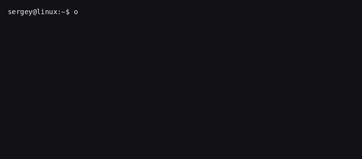

# openfd

[](https://github.com/saromanov/openfd/actions/workflows/ci.yml)
[](https://codecov.io/gh/saromanov/openfd)
[](https://github.com/saromanov/openfd/actions/workflows/release.yml)
[](LICENSE-MIT)
[](https://crates.io/crates/openfd)
[](https://docs.rs/openfd-core)

**lsof that answers instantly** — a fast, streaming file-descriptor scanner for Linux.



`lsof` on busy systems takes minutes, burns a full CPU core and can exhaust memory
([Red Hat knowledge base](https://access.redhat.com/solutions/7002308)). `openfd` reads
`/proc` directly, streams the result as it scans, and answers in milliseconds —
with output a human can actually read.

```console
$ openfd -p 85816
zsh                     85816 sergey            0 chr        /dev/null
zsh                     85816 sergey            1 socket     socket:[29235180]
zsh                     85816 sergey            2 socket     socket:[29235182]

$ openfd -d | head -4
chrome                 15198 sergey            5 file       /home/sergey/.config/google-chrome/BrowserMetrics/BrowserMetrics-6ADED192-3B5E.pma (deleted)
chrome                 15290 sergey           31 file       /tmp/.com.google.Chrome.Auk2yT (deleted)
chrome                 15453 sergey           23 file       /tmp/.com.google.Chrome.N8rqrE (deleted)
chrome                 15462 sergey           31 file       /tmp/.com.google.Chrome.M05bqc (deleted)
openfd: 168 deleted file(s) hold 342770063 reclaimable bytes
```

## Why

- **Streaming by construction.** The first line prints while the scan is still
  running; a full snapshot is never materialized. The lsof OOM case
  (hundreds of thousands of fds) is closed architecturally, not by tuning.
  Rows of one process stay ordered; on multi-core scans rows of different
  processes may interleave.
- **Fast.** On a desktop with ~300 processes, a full terse scan (`-t -n`)
  takes ~20 ms wall clock; the same `lsof -t -n -P` takes ~6.6 s on the same
  box. That lsof number is not a controlled run: the desktop's `mountinfo`
  lists network mounts and a few processes sit in uninterruptible (`D`)
  state, which lsof resolves before it answers. In the controlled container
  without network mounts, lsof takes 2.0 s at 100k fds. Controlled
  measurements: [BENCHMARKS.md](BENCHMARKS.md) — 100k fds: openfd
  0.71 s / 3 MiB (0.48 s spread across 100 processes) vs lsof 2.0 s / 42 MiB
  vs lsfd 2.8 s / 140 MiB.
- **No unsafe in our code, no network.** The core and CLI are pure safe
  Rust (`std` only). The one dependency with system access is
  [`netlink-sys`](https://crates.io/crates/netlink-sys), used for a single
  netlink SOCK_DIAG socket; everything else is `readlink`, `fdinfo`, `stat`.
  No DNS, no downloads, static binary, no runtime dependencies.
- **Reclaimable bytes.** `--deleted` is not just a list — it sums the disk
  space held by unlinked-but-open files (the "why didn't the disk free up
  after I deleted the log" case).
- **Sockets without shell glue.** TCP/UDP/unix endpoints and TCP states come
  from one bulk netlink SOCK_DIAG dump per scan, joined to fds by inode —
  no `ss`/`lsof`/`awk` pipelines.

## Install

From crates.io (Rust 1.88+):

```sh
cargo install openfd
```

Homebrew (Linux):

```sh
brew install saromanov/tap/openfd
```

From source (Rust 1.88+):

```sh
git clone https://github.com/saromanov/openfd
cd openfd
cargo install --path crates/cli
```

Prebuilt binaries: see [Releases](https://github.com/saromanov/openfd/releases).

Man page: [`man/openfd.1`](man/openfd.1) — install with
`install -Dm644 man/openfd.1 /usr/local/share/man/man1/openfd.1`.

## Usage

```
openfd [OPTIONS]

  -p, --pid <PIDS>        comma-separated pids (-p in lsof)
  -c, --command <NAMES>   comma-separated command names (comm + cmdline basename)
  -u, --user <USERS>      comma-separated users (names or uids)
  -f, --fd <FDS>          comma-separated fd numbers
      --path <SUBSTR>     match target paths by substring
      --dir <DIR>         only fds under DIR (lsof +D)
  -i, --inet [SPEC]       socket filter: bare -i, tcp, udp, unix, :443,
                          tcp:443, @127.0.0.1:8080 (literal IPs, no DNS)
  -d, --deleted           only unlinked-but-open files (reclaimable bytes)
  -t, --terse             print pids only
  -s, --summary           per-process summary + kind totals + top shared files
      --tree              group output as a process tree (table format only)
  -n, --numeric           skip username resolution (faster)
      --sizes             stat every fd and show sizes
      --top [N]           fd-leak detector: growth between two scans
      --watch             live mode: + for opened fds, - for closed ones
      --wait              block until no entry matches the filters
      --interval <SEC>    poll interval for --watch/--top/--wait (default 1)
      --nice <N>          run at this nice value (0-19) to stay polite on busy systems
  -j, --json              NDJSON output (streaming, one object per line)
      --csv               CSV output
      --color <WHEN>      auto (default) | always | never
      --completions <SHELL>  print completion script (bash/zsh/fish/powershell)

Subcommands:
  why <TARGET>            explain who holds a file, directory, mountpoint or
                          port, and how to release it (read-only)
  leak [FILTERS]          watch fds over time: growth rate, ETA to EMFILE,
                          what is growing and why (read-only)
```

Groups of the same kind are OR-composed (like lsof), different groups AND-composed:

```sh
openfd -c chrome,code          # fds of chrome or code
openfd -u postgres -d          # deleted files held by postgres
openfd --path /var/log -t      # pids touching /var/log
openfd -i :443                 # who holds port 443
openfd -i tcp                  # all TCP sockets with addresses and states
openfd --watch -c python       # live fd churn of python processes
openfd --top 5 --interval 2    # fastest fd growers over 2 s
openfd --wait --path app.lock  # exit when nothing holds app.lock anymore
openfd --nice 19               # full scan without crowding out other work
openfd -s                      # 10 000 lines become ~50 per-process rows
openfd --tree -c nginx         # fds grouped under each nginx worker
openfd why /mnt/data           # who keeps the mount busy, and what to restart
openfd why :8080               # which unit/container owns the port
openfd why /var                # deleted-but-open files holding disk space
openfd leak --duration 5m      # who leaks fds, how fast, and how soon EMFILE
openfd leak -c java --json     # scheduling/monitoring mode
```

### `openfd why`: who holds it, and what to do

`umount: target is busy`, `address already in use`, and "I deleted the log but
the disk is still full" all stop at the pid. `why` answers the next question
in one step:

```console
$ openfd why /mnt/data
/mnt/data (ext4, /dev/sdb1) is busy: 3 processes, 4 references

OWNER                 PID    COMMAND  HOW    TARGET
nginx.service         812    nginx    fd 7   /mnt/data/logs/access.log
user@1000/session-3   4410   bash     cwd    /mnt/data/project
docker:3f2a9c         9921   app      mmap   /mnt/data/lib/libfoo.so

fix:
  systemctl restart nginx.service       # nginx holds the target
  cd out of /mnt/data/project           # pid 4410 (bash, pts/3) has its cwd inside
  docker restart 3f2a9c                 # container docker:3f2a9c holds the target
```

It reports every way a resource can be held (`fd`, `cwd`, `root`, `exe`,
`mmap`, file `lock`, nested `submount`), resolves each pid to its systemd
unit, user session, Docker/Podman/containerd container or Kubernetes pod via
`/proc/<pid>/cgroup`, sums deleted-but-open bytes, and prints copy-pasteable
hints with a reason. Hints are **never executed**. Mount targets match by
`mnt_id`, so a dead NFS mount cannot block the scan in `D` state.

`--json` streams one object per holder plus a summary; the schema is in
[docs/json.md](docs/json.md). Exit codes match `fuser`/`grep`: `0` found,
`1` nothing holds the target, `2` error. `-q` prints nothing and only sets
the code.

### `openfd leak`: how soon will it hit `EMFILE`?

An fd leak surfaces as `accept(): Too many open files` at 3 a.m. `openfd
leak` replaces the usual `while sleep 10; do ls /proc/$PID/fd | wc -l; done`
script with limit-aware diagnosis:

```console
$ openfd leak -c orders --interval 10s --duration 5m
observed 312 processes for 5m (30 samples); 1 leaking

pid 3120  java  (sergey, orders.service)
  fds        8 412 / 65 536 soft limit  (12.8%)
  growth     +38.2 fd/min  (steady, R²=0.97)
  ETA        ~24h 55m to EMFILE
  breakdown  (new fds since start, by signature)
    +171   tcp -> 10.0.0.5 CLOSE-WAIT
  verdict    CLOSE-WAIT accumulation: the application never closes accepted
             sockets (check response and error paths)
```

- **Robust growth**: least-squares fit over the whole window with R², not a
  two-sample delta; flat/sawtooth pools stay quiet.
- **Limit aware**: compares against the soft `RLIMIT_NOFILE` from
  `/proc/<pid>/limits` and computes the ETA.
- **What grows**: new fds grouped by signature - peer address + TCP state,
  normalized path, `anon_inode` subtype - so 171 CLOSE_WAIT sockets become
  one row.
- **Why**: a verdict names the likely bug.
- **Monitoring mode**: `--json` NDJSON; exit `0` no leak, `1` leak, `2`
  error, `3` `--fail-if-eta` breached (for example `--fail-if-eta 24h`).
- Durations accept `500ms`, `30s`, `5m`, `2h`, `1d`.

The report is read-only: nothing is restarted, killed or truncated.

Long scans from cron or monitoring benefit from `--nice 19`: the scan keeps
its wall-clock speed but yields the CPU whenever anything else wants it.

## How it compares

openfd is not trying to be a drop-in lsof replacement (see [Honest scope](#honest-scope-mvp)).
It competes on the questions you actually ask, answered instantly:

| | openfd | lsof 4.99.4 | lsfd (util-linux 2.41) |
|---|---|---|---|
| Streaming output, flat memory | yes | no — buffers everything | no — grows with fd count |
| 100k fds, full scan | **0.71 s** / 3 MiB | 2.0 s / 42 MiB | 2.8 s / 140 MiB |
| 100k fds spread over 100 processes | **0.48 s** | 2.0 s | 2.9 s |
| 10k fds, full scan | **0.08 s** | 0.21 s | 0.28 s |
| Parallel scan (multi-core) | yes | no | no |
| `--watch` live diff (+/− per fd) | yes | no | no |
| `--top` fd-leak detector | yes | no | no |
| `why` (owner + hint for busy paths/ports) | yes | no | no |
| `leak` (growth, R², ETA to EMFILE, verdict) | yes | no | no |
| `--wait` (block until released) | yes | no | no |
| `--deleted` + reclaimable bytes | yes | lists, no byte total | no |
| Per-process summary / process tree | yes | no | no |
| NDJSON + CSV streaming | yes | no | JSON only |
| Colors, completions, man page | yes | no completions | completions only |
| Port/process coverage | 80/20 subset | the full lsof language | wide |
| Platforms | Linux | many (incl. macOS, AIX) | Linux |

Numbers from [BENCHMARKS.md](BENCHMARKS.md): same machine, same minute,
hyperfine, one process holding 10k/100k fds.

Where lsof still wins: exotic flag surface (`-Z`, NFS details, library
mappings, the full query grammar) and non-Linux platforms. Where lsfd wins:
it ships in util-linux, so it is already installed almost everywhere.
openfd wins when you need the answer in milliseconds, a live view, or a
scriptable machine format without shell glue.

## Honest scope (MVP)

This MVP covers the common 20% of the lsof surface. **Not yet implemented**
(and tracked on the roadmap): `+L`/`+M` style offsets-in-memory views, NFS/FS
details and macOS support (Linux-only for now). If a flag is missing,
`openfd` exits with an error — scripts should keep lsof until the flag they
need lands.

## Permissions: what you can see as whom

openfd reads `/proc` and one netlink socket — so its visibility is exactly
the kernel's, no more:

| How openfd runs | What it sees |
|---|---|
| as your user | fds and sockets of **your own** processes only |
| `sudo openfd` / `CAP_SYS_PTRACE` | every user's fds and the full socket table |
| `/proc` mounted with `hidepid=2` | same as unprivileged; `sudo` still sees everything |

- **Unprivileged.** `/proc/<pid>/fd` is readable only when the kernel grants
  ptrace access, so scans cover your own processes. The netlink SOCK_DIAG
  dump is filtered the same way: the kernel returns only your own sockets.
  If a source is inaccessible, openfd degrades gracefully — it prints what
  it can instead of failing.
- **With sudo / `CAP_SYS_PTRACE`.** Every process' fds become readable and
  the SOCK_DIAG dump returns sockets of all users. Endpoints and TCP states
  for other users' sockets come from that one bulk netlink dump, joined to
  fds by socket inode — no shell pipelines over `ss`/`lsof`.
- **`hidepid=2`.** Other users' `/proc/<pid>` entries disappear entirely.
  Unprivileged behavior does not change (it was already own-processes-only);
  running under `sudo` still sees the whole system.

## Architecture

- [`openfd-core`](crates/core) — the library: `/proc` scanner, fd classification,
  user lookup, mountinfo and cgroup parsers, holder collection and the hint
  engine, plus the `Backend` trait (platform abstraction, day-one separation
  so a macOS libproc backend can land without CLI changes).
- [`openfd`](crates/cli) — the binary: clap-based filters, streaming table /
  NDJSON / CSV printers, per-process summary with kind totals and top shared
  files, `--tree` process grouping.

Core contains no unsafe code and performs no network access.

## Project

- [Changelog](CHANGELOG.md) · [Roadmap](ROADMAP.md) · [Benchmarks](BENCHMARKS.md)
- [Contributing](CONTRIBUTING.md) · [Security policy](SECURITY.md) · [Code of conduct](CODE_OF_CONDUCT.md)
- Questions and ideas: [Discussions](https://github.com/saromanov/openfd/discussions)

## License

Dual-licensed under [MIT](LICENSE-MIT) or [Apache-2.0](LICENSE-APACHE), at your option.
